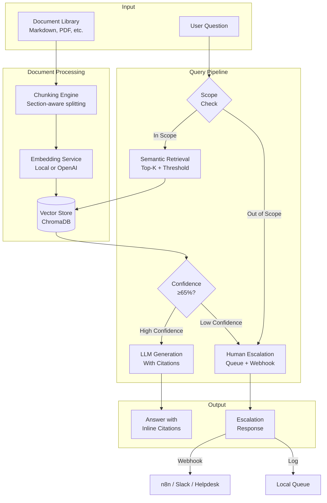

# Document Q&A Assistant with Citations and Human Handoff

> A production-ready RAG (Retrieval-Augmented Generation) system that answers questions from your document library with inline source citations, and intelligently escalates to human support when it can't confidently answer.

[](https://www.python.org/downloads/)
[](https://fastapi.tiangolo.com/)
[](https://opensource.org/licenses/MIT)

---

## The Problem

Companies struggle with knowledge management at scale:

- **Support teams** answer the same questions repeatedly
- **Documentation** exists but users can't find what they need
- **Chatbots** hallucinate when they don't know the answer
- **Escalations** happen too late—after a wrong answer frustrates the customer

This project demonstrates a solution: an AI assistant that **only answers from verified sources**, **always cites its sources**, and **knows when to escalate to a human**.

---

## Solution Architecture



---

## Key Features

### 1. Grounded Answers with Citations

Every answer is generated **only** from retrieved document chunks. The system includes inline citations so users can verify the source:

```
Q: What are the core working hours for remote employees?

A: Remote employees must be available during core hours: 10:00 AM - 3:00 PM 
in their local timezone [Source: Remote Work Policy]. Outside core hours, 
employees have flexibility in scheduling their remaining work hours.
```

### 2. Intelligent Escalation

The system escalates to human support when:

- **Retrieval confidence is low** (< 65% similarity score)
- **Question is out of scope** (competitors, legal advice, etc.)
- **No relevant documents found**

Escalations are logged locally (JSON Lines) and optionally sent to a webhook (compatible with n8n, Zapier, Slack, or any helpdesk).

### 3. Configurable LLM & Embeddings

| Provider | Models | Use Case |
|----------|--------|----------|
| **OpenAI** | gpt-4o, gpt-4o-mini | Production with API key |
| **Anthropic** | claude-3-haiku, claude-3-sonnet | Alternative LLM |
| **Local** | all-MiniLM-L6-v2 | Embeddings without API (default) |

Switch providers via environment variables—no code changes needed.

---

## Quick Start

### Prerequisites

- Python 3.10+
- 2GB disk space (for local embeddings model)

### Installation

```bash
# Clone and enter directory
git clone https://github.com/asanjaye/rag-doc-qa.git
cd rag-doc-qa

# Create virtual environment
python -m venv venv
source venv/bin/activate  # Windows: venv\Scripts\activate

# Install dependencies
pip install -r requirements.txt

# Configure (copy and edit)
cp .env.example .env
# Edit .env with your API keys (or leave empty for mock mode)
```

### Run the Server

```bash
python main.py
```

Open [http://localhost:8742](http://localhost:8742) for the web UI.

### Run via CLI

```bash
# Single question
python -m src.cli query "What is the PTO policy?"

# Interactive mode
python -m src.cli interactive

# View escalations
python -m src.cli escalations
```

---

## Configuration

All settings via environment variables (`.env` file):

```bash
# LLM Provider: openai | anthropic
LLM_PROVIDER=openai
OPENAI_API_KEY=sk-your-key-here
OPENAI_MODEL=gpt-4o-mini

# Embedding Provider: openai | local
EMBEDDING_PROVIDER=local  # Uses sentence-transformers, no API needed

# RAG Tuning
CONFIDENCE_THRESHOLD=0.65  # Below this → escalate
MAX_CHUNKS=5               # Context window size
CHUNK_SIZE=500             # Characters per chunk

# Human Handoff
ESCALATION_WEBHOOK_URL=https://your-n8n-instance/webhook/xyz
ESCALATION_LOG_FILE=escalations.jsonl
```

---

## API Reference

### Query Documents

```bash
POST /api/query
Content-Type: application/json

{
  "question": "What databases does DataSync Pro support?"
}
```

**Response:**

```json
{
  "request_id": "a1b2c3d4",
  "question": "What databases does DataSync Pro support?",
  "answer": "DataSync Pro supports PostgreSQL 12+, MySQL 8.0+, MongoDB 5.0+, Snowflake, and BigQuery [Source: Supported Connectors].",
  "citations": [
    {
      "source_file": "docs/knowledge_base/product_documentation.md",
      "section": "Supported Connectors",
      "relevance_score": 0.89,
      "snippet": "**Databases:**\n- PostgreSQL 12+\n- MySQL 8.0+..."
    }
  ],
  "confidence": 0.89,
  "escalated": false,
  "model_used": "gpt-4o-mini",
  "tokens_used": 342
}
```

### Index Documents

```bash
POST /api/index
Content-Type: application/json

{
  "directory": "./docs/knowledge_base"  # Optional, uses default
}
```

### Get Escalations

```bash
GET /api/escalations?limit=20
```

### Health Check

```bash
GET /health
```

---

## Evaluation

The project includes a comprehensive evaluation suite with 20 test questions covering:

- ✅ Answerable policy questions
- ✅ Answerable product questions  
- ✅ FAQ coverage
- ⚠️ Out-of-scope detection (should escalate)
- ⚠️ Low-confidence detection (should escalate)
- 🔥 Tricky multi-source questions

### Run Evaluation

```bash
python evals/run_eval.py
```

**Measured results (synthetic docs, mock LLM — no API key):**

These numbers come from running `python evals/run_eval.py` against the included NovaTech synthetic knowledge base with `EMBEDDING_PROVIDER=local` and no LLM credentials (mock generator). Answer/citation checks fail when the mock reply does not contain expected phrases; escalation behavior is still exercised.

```
Overall Metrics
  • Answer Correctness:    4/20 (20.0%)
  • Citation Accuracy:     5/20 (25.0%)
  • Escalation Accuracy:   13/20 (65.0%)

Escalation Stats
  • Expected Escalations:  4
  • Actual Escalations:    11
  • Escalation Rate:       55.0%

By category (escalation accuracy)
  • escalate: 4/4 (100%)
  • faq:      3/4 (75%)
  • policy:   2/5 (40%)
  • product:  3/5 (60%)
  • tricky:   1/2 (50%)
```

Unit tests: **19 passed** (`pytest tests/ -v`).

Results are saved to `evals/results/` as JSON for tracking over time. Re-run with a real `OPENAI_API_KEY` or `ANTHROPIC_API_KEY` to measure end-to-end answer quality; do not treat the mock figures above as production LLM accuracy.

---

## Extending to Your Documents

### 1. Replace the Knowledge Base

```bash
# Remove demo documents
rm -rf docs/knowledge_base/*

# Add your documents (Markdown supported)
cp /path/to/your/docs/*.md docs/knowledge_base/

# Re-index
curl -X POST http://localhost:8742/api/index
```

### 2. Adjust Chunking for Your Content

```bash
# In .env
CHUNK_SIZE=800     # Larger for longer documents
CHUNK_OVERLAP=100  # More overlap for context continuity
```

### 3. Connect to Your Helpdesk

**n8n Webhook:**
```bash
ESCALATION_WEBHOOK_URL=https://your-n8n.com/webhook/document-qa-escalation
```

**Slack Incoming Webhook:**
```bash
ESCALATION_WEBHOOK_URL=https://hooks.slack.com/services/T00/B00/xxx
```

The webhook receives:
```json
{
  "event": "human_handoff_required",
  "data": {
    "question": "...",
    "reason": "Retrieval confidence too low (max: 0.42)",
    "timestamp": "2024-01-15T10:30:00Z",
    "request_id": "abc123"
  }
}
```

---

## Testing

```bash
# Run all tests
pytest tests/ -v

# Run with coverage
pytest tests/ -v --cov=src --cov-report=term-missing
```

---

## Project Structure

```
document-qa-assistant/
├── src/
│   ├── api/           # FastAPI application
│   │   └── app.py     # Routes and endpoints
│   ├── rag/           # RAG pipeline components
│   │   ├── document_processor.py  # Chunking
│   │   ├── embeddings.py          # Embedding services
│   │   ├── retriever.py           # Vector search
│   │   ├── generator.py           # LLM interface
│   │   ├── escalation.py          # Human handoff
│   │   └── pipeline.py            # Orchestration
│   ├── cli.py         # Command-line interface
│   └── config.py      # Settings management
├── docs/
│   └── knowledge_base/  # Your documents go here
├── evals/
│   ├── eval_questions.yaml  # Test cases
│   └── run_eval.py          # Evaluation script
├── tests/             # Pytest test suite
├── templates/         # Web UI templates
├── main.py           # Server entry point
├── requirements.txt  # Dependencies
├── .env.example      # Configuration template
├── DEMO.md           # Demo walkthrough script
└── README.md         # This file
```

---

## Production Considerations

Before deploying to production:

1. **API Keys**: Use secrets management (not .env files)
2. **Persistence**: Mount `/data/chroma` to persistent storage
3. **Rate Limiting**: Add middleware for public endpoints
4. **Monitoring**: Connect escalation webhook to alerting
5. **Scaling**: Consider managed vector DB (Pinecone, Weaviate) for large document sets

---

## License

MIT License — see [LICENSE](LICENSE).

---

## About

Built by **Ashwin Sanjaye**.

- Portfolio: [ashwinsanjaye.com](https://ashwinsanjaye.com)
- GitHub: [github.com/asanjaye](https://github.com/asanjaye)
- Email: [sanjaye@usc.edu](mailto:sanjaye@usc.edu)
- Repository: [github.com/asanjaye/rag-doc-qa](https://github.com/asanjaye/rag-doc-qa)

This project showcases:
- RAG system design and implementation
- LLM integration with multiple providers
- Production patterns (confidence scoring, graceful degradation, human-in-the-loop)
- Professional documentation and evaluation practices
